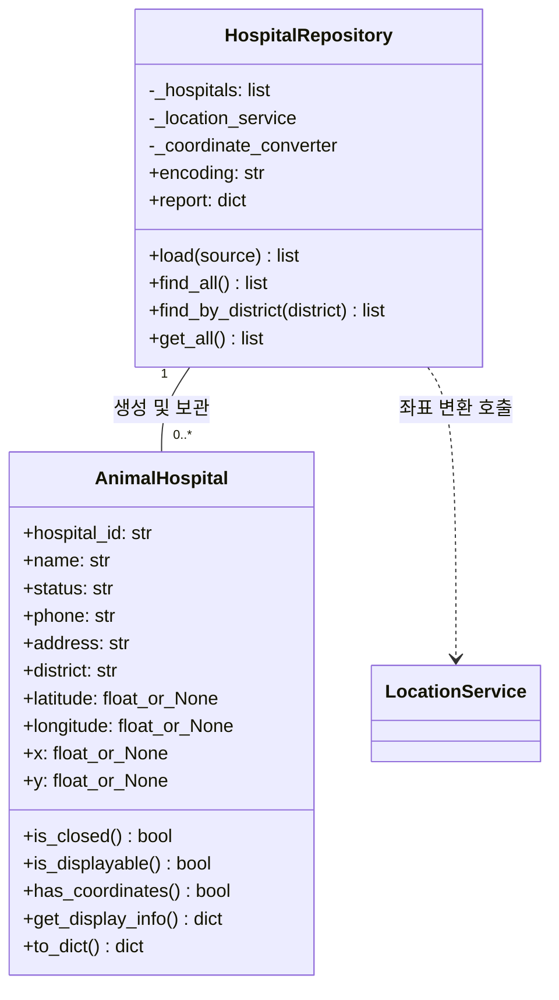
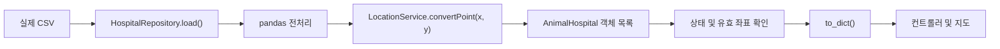

# 데이터 클래스 최종 연결 안내

담당 이승훈 · AnimalHospital / HospitalRepository · 2026-11-28

## 역할과 객체 관계

| 클래스 | 책임 | 주요 속성 | 주요 메서드 |
|---|---|---|---|
| AnimalHospital | 병원 한 곳의 정보 보관 및 지도 표시 조건 판단 | hospital_id, name, status, phone, address, district, latitude, longitude, x, y | is_closed(), is_displayable(), has_coordinates(), get_display_info(), to_dict() |
| HospitalRepository | CSV 전처리, 병원 객체 생성·보관, 전체 및 자치구별 조회 | _hospitals, _location_service, _coordinate_converter, encoding, report | load(source), find_all(), find_by_district(district), get_all() |

AnimalHospital은 생성 후 속성 재대입이 금지된 dataclass이다. Repository는 병원 객체 목록을 보관한다. 조회할 때 새 목록 또는 새 딕셔너리를 반환하므로 목록·딕셔너리 수정이 저장소 내용을 바꾸지 않는다.



## 설치 및 실행

프로젝트 최상위에서 실행한다. 실제 위치 서비스는 최상위 location_service.py에 있다. src/location_service.py와 src/user_location.py는 현재 기본 틀이다.

```sh
python -m pip install -r requirements.txt
python -m examples.data_classes_demo
python -m unittest discover -s tests -p "test_repository_coordinates.py" -v
```

실행 예시는 기본 좌표 (37.6194, 127.0598)와 반경 2km를 사용한다. 지도·주소 API 없이 실제 CSV 전처리와 좌표 변환·거리 검색을 확인한다. 반경과 좌표는 실행 옵션으로 바꿀 수 있다.

```sh
python -m examples.data_classes_demo --district 마포구 --latitude 37.6194 --longitude 127.0598 --radius-km 2
```

## 팀원이 사용할 연결 코드

```python
from location_service import LocationService, UserLocation
from src.hospital_repository import HospitalRepository
from src.dashboard_controller import DashboardController

service = LocationService()
repository = HospitalRepository(service)
repository.load("data/seoul_animal_hospitals.csv")
controller = DashboardController(repository)

# 객체 목록 조회
mapo_hospitals = repository.find_by_district("마포구")
map_ready = [
    h for h in repository.find_all()
    if h.is_displayable() and h.has_coordinates()
]

# 현재 지도 브랜치의 render_hospitals()가 받는 딕셔너리 목록
records = [h.to_dict() for h in map_ready]
# view.render_hospitals(records)  # 지도 담당 코드 통합 후 사용

# 실제 주소 검색 예시. 네트워크·주소 제공자 설정 필요
# user = UserLocation()
# nearby = controller.search_nearby(
#     "서울특별시 노원구 광운로 20", 2.0, service, user
# )
```

위치 서비스의 convertPoint(x, y)를 그대로 사용할 수 있다. 기존 convert_coordinates(x, y)도 지원한다. 둘 다 있으면 convert_coordinates를 우선한다. 두 방식의 반환 순서는 (위도, 경도)이다.

원본 X/Y가 비었거나 숫자가 아니거나 0 이하이면 변환을 호출하지 않는다. 변환 결과가 None, NaN, 무한대 또는 위경도 범위 밖이면 latitude/longitude를 None으로 저장한다. 병원 행 자체는 유지한다. 서비스가 예외를 발생시키면 load()를 실패시키고 이전 병원 목록과 report를 유지한다.

위치 서비스를 생략해 생성한 저장소는 X/Y만 보관하고 위경도는 None으로 둔다. 서비스를 연결한 저장소에서 load()를 다시 호출해야 지도 좌표가 채워진다.

## 주요 메서드의 입력과 출력

| 메서드 | 입력 또는 사용하는 상태 | 처리 | 출력 |
|---|---|---|---|
| load(source) | CSV 파일 경로 또는 bytes | pandas 전처리, 좌표 변환, 객체 생성 | list[AnimalHospital] |
| find_all() | 저장된 병원 목록 | 전체 목록의 사본 생성 | 모든 상태의 객체 목록 |
| find_by_district("마포구") | 자치구 문자열 | district 비교 | 해당 구의 모든 상태 객체 목록 |
| find_by_district("서울 전체") | "서울 전체" | 전체 객체 선택 | 모든 상태의 객체 목록 |
| get_all() | 저장된 병원 목록 | 각 객체의 to_dict() 호출 | list[dict] |
| is_closed() | 객체의 status | 폐업인지 확인 | bool |
| is_displayable() | 객체의 status | 정상 영업 또는 휴업인지 확인 | bool |
| has_coordinates() | 객체의 위도·경도 | 누락·유한성·위경도 범위 확인 | bool |
| get_display_info() | 객체의 이름·상태·전화·주소 | 말풍선용 정보 구성 | 한글 키의 dict |
| to_dict() | 객체의 모든 병원 정보 | 컨트롤러 전달 형식으로 변환 | 영문 키의 dict |

AnimalHospital 메서드는 별도 인자를 받지 않고 객체에 저장된 정보를 사용한다. 그림에서는 병원 객체의 상태 → 메서드 → 반환값으로 표현한다.



## pandas 전처리 기준

1. UTF-8 BOM, CP949, EUC-KR 순으로 인코딩을 확인하고 문자열로 읽는다.
2. 열 이름과 셀 앞뒤 공백을 제거하고 필요한 열을 확인한다.
3. 관리번호·병원명이 없거나 필드가 부족한 행을 제외한다.
4. 같은 관리번호는 원본에서 먼저 나온 행을 유지한다.
5. 상태 코드를 우선 사용해 정상 영업·휴업·폐업·기타 상태로 통일한다.
6. 도로명주소를 우선하고 없으면 지번주소를 사용한다. 자치구도 주소에서 추출한다.
7. 관리번호·전화번호의 앞자리 0은 유지하고 X/Y만 숫자로 바꾼다.
8. 유효한 X/Y를 팀 위치 서비스로 변환하고 병원 객체를 생성한다.

## 반환 형식

| get_all()/to_dict() 키 | 내용 |
|---|---|
| id / name | 관리번호 문자열 / 병원명 |
| status | 영업 / 휴업 / 폐업 / 기타 상태 |
| status_label | 정상 영업 / 휴업 / 폐업 / 기타 상태 |
| phone / address / gu | 전화번호 / 주소 / 자치구 |
| lat / lng | 위도 / 경도, 없으면 None |
| x / y | 원본 좌표, 유한한 숫자가 아니면 None |

객체 내부 정상 상태는 "정상 영업"이며, to_dict()의 status는 팀 컨트롤러에 맞춰 "영업"으로 변환한다. get_display_info()는 병원명·영업상태·전화번호·주소를 한글 키로 반환하고 전화·주소가 비면 "정보 없음"으로 표시한다.

## 실제 CSV 확인 결과

현재 저장소의 CSV 2,242행을 사용해 확인했다. 데이터가 바뀌면 수치도 달라진다.

| 항목 | 결과 |
|---|---|
| 전체 로딩 | 2,242개 |
| 정상 영업 / 휴업 | 985개 / 10개 |
| 폐업 / 기타 상태 | 1,241개 / 6개 |
| 마포구 전체 상태 | 121개 |
| 정상 또는 휴업 | 995개 |
| 정상 또는 휴업이면서 유효 좌표 있음 | 983개 |
| 정상 또는 휴업 중 좌표 없음 | 12개 |
| 예시 좌표 기준 2km 이내 정상·휴업 | 21개 |
| 회귀 및 연결 테스트 | 7개 통과 |

테스트에서 주소 검색은 고정 좌표로 대체했고, 거리 계산은 실제 팀원 메서드를 사용했다. 실제 주소 API와 지도 화면은 별도 통합 확인이 필요하다.

## 수정 범위와 통합 시 확인할 점

- HospitalRepository에 두 좌표 메서드 이름을 지원하는 연결과 좌표 검증을 추가했다.
- AnimalHospital의 기존 속성과 메서드, 전달 키를 유지했다.
- DashboardController의 search_nearby 선언에서 들여쓰기 한 칸을 수정해 import 오류를 해결했다.
- 실제 위치 코드에 필요한 numpy, requests, pyproj를 requirements.txt에 추가했다.
- 현재 get_dashboard_data()/get_district_counts()는 정상 영업만 선택한다. 휴업을 포함하는 전체 지도·집계 조건은 화면 담당자와 맞춰야 한다.
- 지도 브랜치 통합, 주소 입력 화면, 키·도메인 설정과 전체 사이트 실행은 통합 담당자가 이어서 확인한다.

## 발표용 설명

“AnimalHospital은 병원 한 곳의 정보와 상태 판단을 담당하고, HospitalRepository는 pandas로 CSV를 전처리한 뒤 병원 객체를 생성하고 보관합니다. 원본 X/Y는 위치 서비스에 전달해 위도와 경도로 바꿉니다. 지역 선택 시 자치구에 맞는 객체를 조회하고, 지도에는 정상 영업·휴업 여부와 유효 좌표를 함께 확인한 데이터를 전달합니다. 현재 CSV에서 상태 조건을 만족하는 병원은 995개이며, 이 중 좌표까지 있는 983개를 지도에 전달할 수 있습니다.”
